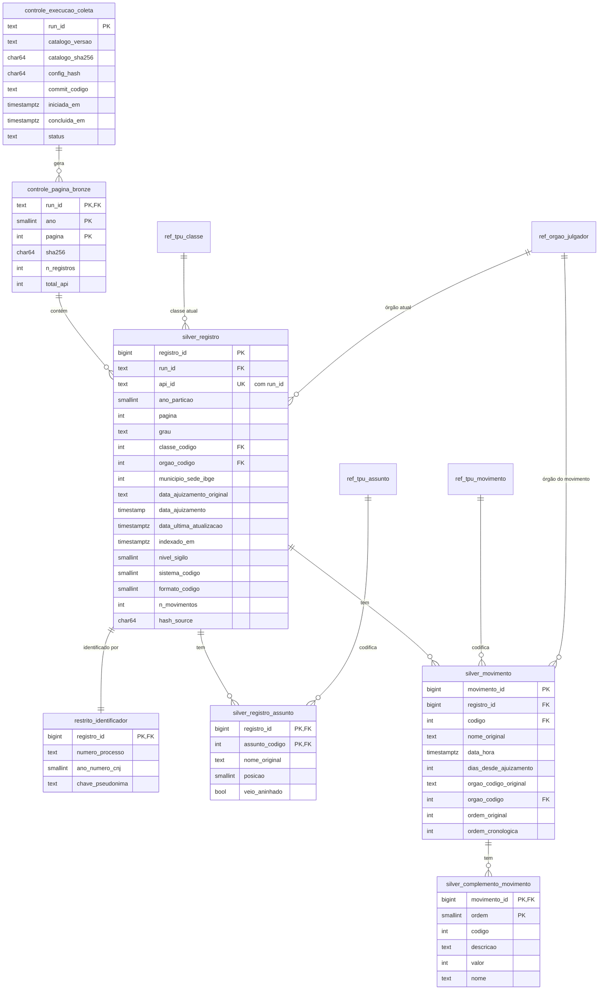

# Modelo de dados da camada Silver — proposta

Data: 23/10/2026 (atualizado em 05/11/2026). Status: **proposta de desenho**; a parte de dados originais (`controle`, `silver`, `restrito`) está implementada (seção 9). `ref`, `deriv` e `gold` seguem como proposta. Baseia-se nos achados de `06`, `07` e `08` e no CLAUDE.md §8–§13. As escolhas marcadas como "a decidir" dependem do autor.

## 1. Princípios

1. **Original separado de derivado.** As tabelas `silver.*` guardam o que a API trouxe, só tipado e normalizado. Tudo o que o projeto infere (tipo de procedimento, grupo, categorias, eventos, flags) fica em tabelas `deriv.*`, **ligadas a uma versão de regras**. Mudar uma regra cria uma nova versão; nada é sobrescrito em silêncio.
2. **Uma tabela por relação de cardinalidade diferente.** Assuntos, movimentos e complementos ficam separados, para evitar o produto cartesiano (3 assuntos × 20 movimentos = 60 linhas, CLAUDE.md §9).
3. **Rastreabilidade até a Bronze.** Cada registro aponta para a execução, o ano e a página de origem. O SHA-256 da página permite verificar o dado.
4. **Carga idempotente.** A chave natural é `(run_id, api_id)`. Recarregar a mesma execução não duplica nada.
5. **Valores originais preservados ao lado dos convertidos:** datas como texto e como `timestamp`, nomes como a API trouxe.
6. **Privacidade por camada.** O número do processo fica numa tabela de acesso restrito; o restante usa uma chave substituta (CLAUDE.md §13).
7. **Referências versionadas e com fonte:** TPU (SGT), catálogo temático, comarcas e municípios, com data de consulta e vigência.

## 2. Esquemas

| Esquema | Conteúdo |
|---|---|
| `controle` | Execuções de coleta, páginas da Bronze, cargas na Silver |
| `silver` | Dados originais normalizados |
| `ref` | Tabelas de referência: TPU, catálogo, órgãos, territórios |
| `deriv` | Classificações e eventos derivados por regra versionada |
| `restrito` | Identificadores processuais (acesso limitado) |
| `gold` | Agregações e visões para o dashboard (fora deste documento) |

## 3. Diagrama — núcleo (dados originais)



## 4. Diagrama — referências e derivados

```mermaid
erDiagram
    ref_tpu_assunto ||--o{ ref_tpu_assunto : "pai"
    ref_tpu_movimento ||--o{ ref_tpu_movimento : "pai"
    ref_versao_regras ||--o{ ref_catalogo_tematico : "define"
    ref_versao_regras ||--o{ ref_classe_tipo_procedimento : "define"
    ref_versao_regras ||--o{ ref_regra_evento : "define"
    ref_versao_regras ||--o{ ref_categoria_codigo : "define"
    ref_municipio ||--o{ ref_comarca_municipio : "atendido por"
    ref_comarca ||--o{ ref_comarca_municipio : "abrange"
    ref_comarca ||--o{ ref_orgao_julgador : "sedia"
    ref_regiao ||--o{ ref_municipio : "agrupa"

    silver_registro ||--o{ deriv_classificacao : "classificado"
    ref_versao_regras ||--o{ deriv_classificacao : "versão"
    silver_registro ||--o{ deriv_registro_categoria : "categorias"
    silver_registro ||--o{ deriv_evento : "eventos"
    silver_movimento ||--o{ deriv_evento : "origem"
    silver_registro ||--o{ deriv_tempo : "tempos"
    silver_registro ||--o{ deriv_flag_qualidade : "flags"

    ref_versao_regras {
        text versao PK
        date criada_em
        text descricao
        text documento
    }
    ref_tpu_assunto {
        int codigo PK
        text nome
        int pai_codigo FK
        text caminho
        text fonte
        date consultado_em
    }
    ref_tpu_movimento {
        int codigo PK
        text nome
        int pai_codigo FK
        text caminho
        date consultado_em
    }
    ref_catalogo_tematico {
        text versao PK,FK
        text tipo PK "assunto ou classe"
        int codigo PK
        text grupo "nucleo, especifica, ambigua, secundaria, marcador"
        text justificativa
    }
    ref_categoria_codigo {
        text versao PK,FK
        text categoria PK
        int assunto_codigo PK
        bool so_serie_ampliada
    }
    ref_classe_tipo_procedimento {
        text versao PK,FK
        int classe_codigo PK
        text tipo "principal, medida_protetiva, incidente, carta, civel, outros"
    }
    ref_regra_evento {
        text versao PK,FK
        int movimento_codigo PK
        text evento "decisao_mpu_concessao, arquivamento_definitivo, julgamento..."
    }
    ref_orgao_julgador {
        int orgao_codigo PK
        text nome
        int municipio_sede_ibge FK
        int comarca_id FK
        text tipo_unidade "JVDFM, criminal, juizo_unico..."
    }
    ref_comarca {
        int comarca_id PK
        text nome
        int sede_ibge
        text entrancia
        date vigente_desde
        date vigente_ate
    }
    ref_comarca_municipio {
        int comarca_id PK,FK
        int municipio_ibge PK,FK
        date vigente_desde PK
        date vigente_ate
        text fonte
    }
    ref_municipio {
        int municipio_ibge PK
        text nome
        int regiao_imediata FK
        int regiao_intermediaria
    }
    ref_regiao {
        int regiao_codigo PK
        text nome
        text tipo
        text fonte
    }
    deriv_classificacao {
        bigint registro_id PK,FK
        text versao PK,FK
        text tipo_procedimento
        text grupo_inclusao
        bool serie_estrita
        bool serie_ampliada
        bool registro_canonico "dedup por numero"
    }
    deriv_registro_categoria {
        bigint registro_id PK,FK
        text versao PK
        text categoria PK
        text motivo
    }
    deriv_evento {
        bigint registro_id FK
        text versao
        text evento
        bigint movimento_id FK
        int dias_desde_ajuizamento
    }
    deriv_tempo {
        bigint registro_id PK,FK
        text versao PK
        int dias_ate_decisao_mpu
        text decisao_mpu
        int dias_ate_fim
        text status_observacao "encerrado, censurado, sem_dados"
        int dias_acompanhamento
    }
    deriv_flag_qualidade {
        bigint registro_id PK,FK
        text versao PK
        text flag PK
        text detalhe
    }
```



## 5. Dicionário resumido e motivos

### Dados originais (`silver`, `restrito`, `controle`)

| Tabela | Grão (uma linha por…) | Volume estimado | Motivo / achado que justifica |
|---|---|---:|---|
| `controle.execucao_coleta` | execução | poucas | Vincula cada dado ao catálogo, à configuração e ao commit (`06`) |
| `controle.pagina_bronze` | página da Bronze | 721 | Rastreabilidade e verificação por SHA-256 |
| `silver.registro` | registro da API (`_id`) | 143 mil | Unidade técnica; classe e órgão são os **atuais** (`07` §3, CLAUDE.md §4.6) |
| `restrito.identificador` | registro | 143 mil | Número do processo isolado (privacidade); `ano_numero_cnj` permite checagens como a de `08` §7.2 |
| `silver.registro_assunto` | registro × assunto | ~270 mil | Multirrótulo (1,9 por registro); `veio_aninhado` marca os 14 registros com lista aninhada (`07` §1) |
| `silver.movimento` | movimento | ~13,5 mi | Ordem original **e** cronológica (CLAUDE.md §7); órgão do movimento original (texto) e normalizado (inteiro) |
| `silver.complemento_movimento` | complemento | ~6–9 mi | Medidas e beneficiário da MPU (`07` §5); motivo da redistribuição |

### Referências (`ref`)

| Tabela | Conteúdo | Fonte |
|---|---|---|
| `tpu_assunto`, `tpu_classe`, `tpu_movimento` | Nome oficial e hierarquia (autorreferência ao pai) | SGT/CNJ (`evidencias/sgt_tpu_*`, `movimentos_viabilidade_*`) |
| `versao_regras` | Cada versão das regras de classificação | Documento que a justifica |
| `catalogo_tematico` | Códigos e grupos | `config/catalogs/tjpr_vcm_2026-10-18.yaml` |
| `categoria_codigo` | Códigos → categorias analíticas | `07` §8 (a decidir) |
| `classe_tipo_procedimento` | Classe → tipo de procedimento | `07` §2 |
| `regra_evento` | Código de movimento → evento | `07` §5, `08` §2 |
| `orgao_julgador` | 297 órgãos; sede; comarca; tipo de unidade | API + classificação manual do nome |
| `comarca`, `comarca_municipio` | Território atendido, com **vigência** | TJPR (a obter, `09` §4.A) |
| `municipio`, `regiao` | Nomes e regiões imediatas/intermediárias | IBGE (versão a registrar) |

### Derivados (`deriv`), sempre por `versao`

| Tabela | Conteúdo | Origem da regra |
|---|---|---|
| `classificacao` | Tipo de procedimento, grupo de inclusão, série estrita/ampliada, registro canônico (a marca "em análise" não existe na Silver; ver seção 9) | `01`, `07` |
| `registro_categoria` | Categorias multirrótulo com motivo | `07` §8 |
| `evento` | Eventos identificados por código: decisão de MPU (concessão, em parte, não-concessão), revogação, prorrogação, julgamento, trânsito, arquivamento definitivo, reabertura | `07` §5, `08` §2 |
| `tempo` | Primeira decisão de MPU, fim, `status_observacao` (encerrado/censurado/sem dados), tempo de acompanhamento | `08` §4; campos sugeridos no CLAUDE.md §11 |
| `flag_qualidade` | Ver §6 | `07`, `08` |

## 6. Flags de qualidade previstas

| Flag | Regra | Achado |
|---|---|---|
| `marcador_nao_mulher` | assunto 12195 ou 12197 | `07` §1 |
| `marcador_crianca` | assunto 15174 ou 15180 | `07` §1 |
| `infracional_em_classe_criminal` | código infracional em classe criminal comum | `07` §1 |
| `assunto_aninhado` | `assuntos` em lista aninhada (14 registros) | `07` §1; `docs/exemplos/campos_api.json` |
| `numero_multiplo` | número de processo com mais de um registro | `07` §3 (70 números) |
| `inicio_documento` | primeiro movimento = 581 "Documento" | `08` §7.2 |
| `carta_pico_2019_2020` | carta precatória entre jul/2019 e dez/2020 | `08` §7.1 |
| `movimento_antes_ajuizamento` | algum movimento anterior ao ajuizamento | `08` §1 (24 casos) |
| `assunto_sem_nome` | nome ausente na API (15174, 15180) | `07` §1 |
| `classe_invalida` | `classe.codigo` = texto `"-1"` (17 registros) | `docs/exemplos/campos_api.json` |

## 7. Fluxo de carga

```text
Bronze (páginas .json.gz)
  → 1. controle: registra a execução e as páginas (verifica SHA-256)
  → 2. silver: insere registros, assuntos, movimentos, complementos
        (chave (run_id, api_id); conversão de datas; normalização de tipos)
  → 3. ref: carrega TPU (SGT), catálogo, tipos de classe, regras de evento, territórios
  → 4. deriv: para uma versão de regras, recalcula classificação, categorias,
        eventos, tempos e flags (DELETE + INSERT daquela versão)
  → 5. testes de consistência (contagens = Bronze; sem duplicatas; somas por ano)
```

O passo 4 é o único que se repete quando as regras mudam; os passos 1–3 só se repetem com uma nova coleta.

## 8. Decisões em aberto

1. **SGBD:** PostgreSQL, conforme o PDF e o CLAUDE.md §9. Com cerca de 13,5 milhões de movimentos (somente a execução de 18/10/2026; as duas execuções somam cerca de 15 milhões), cabe bem numa instalação local. Alternativa mais leve para o TCC: DuckDB, sem servidor, lendo direto os arquivos. *(a decidir)*
2. **Dados de 2026:** *(resolvido em 05/11/2026)* a Silver carrega todas as execuções, inclusive 2026, sem marcar o que entra na análise; a Gold decide.
3. **Deduplicação:** critério para escolher o registro canônico entre os 70 números com mais de um registro (por exemplo, a atualização mais recente).
4. **Chave pseudônima:** HMAC do número com segredo fora do repositório, se o dashboard precisar de algum identificador estável. Hash não equivale a anonimização (CLAUDE.md §13).
5. **Categorias analíticas e série estrita × ampliada:** `07` §8.
6. **Fonte territorial:** tabela de comarcas do TJPR e versão das regiões do IBGE (`09`).


## 9. Implementação — dados originais (05/11/2026)

**Decisão do autor (05/11/2026).** A Silver guarda **todos os registros de todas as execuções carregadas** e **não marca o que está em análise** (não existe `em_analise`, nem para 2026). A Gold aplica os critérios de análise: período 2019–2026, escolha de uma versão por registro entre execuções (por exemplo, 2026 aparece na coleta de 18/10, na recoleta de 05/11 e nas incrementais), séries estrita e ampliada. Também ficam para a Gold a classificação, os eventos derivados, os tempos, o enriquecimento (IBGE, PostGIS, comarcas) e as agregações. Onde a proposta das seções 1 a 5 colocava classificação, eventos e tempos em um esquema `deriv` ao lado da Silver, essa parte agora pertence à Gold: a escolha do autor é que a Silver contenha apenas dados fiéis à API.

**Implementado** (`src/datajud_tcc/silver/`, PostgreSQL 16.3, banco `tcc_datajud`; DDL em `esquema.sql`, aplicado de forma idempotente):

| Tabela | Observação |
|---|---|
| `controle.execucao_coleta` | Uma linha por execução da Bronze (catálogo, configuração, commit, status) |
| `controle.pagina_bronze` | Uma linha por página, com SHA-256 e total informado pela API |
| `silver.registro` | Chave natural `UNIQUE (run_id, api_id)`; guarda `data_ajuizamento_original` (texto) e `data_ajuizamento` (`timestamp`), `n_movimentos` e `hash_source` |
| `restrito.identificador` | `numero_processo` e `id_source` isolados; só aparecem aqui |
| `silver.registro_assunto` | **PK `(registro_id, posicao)`**, e não `(registro_id, assunto_codigo)`: o mesmo código pode se repetir no mesmo registro e a posição preserva a lista original (inclusive os 14 registros com lista aninhada, marcados em `veio_aninhado`) |
| `silver.movimento` | `ordem_original` e `ordem_cronologica`; órgão do movimento em texto original e normalizado |
| `silver.complemento_movimento` | PK `(movimento_id, ordem)` |

**Regras de normalização** (`normalizacao.py`):

- `dataAjuizamento` vem como texto `YYYYMMDDHHMMSS`, sem fuso. É convertida para `timestamp` sem fuso; se o formato for inválido, o texto original é mantido e `data_ajuizamento` fica NULL (o registro carrega mesmo assim).
- As demais datas (`dataHora` dos movimentos, atualização, indexação) vêm em ISO 8601 com `Z` e são guardadas como `timestamptz`.
- `dias_desde_ajuizamento` = dias inteiros (`.days`) entre a data do movimento, em UTC com o fuso removido, e `data_ajuizamento`. É NULL se qualquer uma das duas faltar. Como o ajuizamento não tem fuso informado, o valor pode divergir em até um dia; é um número de apoio, não um dado da API.
- **Fuso de `dias_desde_ajuizamento` (hipótese não verificada).** `movimentos[].dataHora` chega em ISO com `Z` (UTC declarado) e `dataAjuizamento` chega sem fuso (`YYYYMMDDHHMMSS`). A Silver calcula `dias_desde_ajuizamento` a partir dos date-times ingênuos, sem conversão. Se `dataAjuizamento` for horário local (Brasília, UTC−3), a diferença pode errar em um dia para eventos próximos da meia-noite. Os valores originais são preservados, então a Gold pode recalcular.
- `ordem_cronologica` ordena por `dataHora` (datas ausentes por último) e desempata pela ordem original; a ordem recebida não é presumida cronológica.
- Valores atípicos reais são preservados: assunto aninhado, assunto sem `nome`, `classe.codigo` como texto `"-1"` e movimento sem órgão julgador.

**Carga** (`carga.py`): lê a execução página a página, verifica o SHA-256 de cada página contra o manifesto (divergência aborta sem gravar) e usa `COPY` para movimentos e complementos. Recarregar uma execução não duplica linhas. Funções de biblioteca não fazem `commit`; a CLI faz.

**Fica para o plano seguinte** (depende de decisões do autor): `ref.*` (TPU, catálogo, comarcas, municípios), `deriv.*` e flags de qualidade (na Gold), critérios de seleção da Gold e eventual chave pseudônima. PostGIS 3.6.2 está instalado, mas só será usado na Gold.

**Estado da carga.** A carga inicial real das duas execuções da base do artigo ainda não foi executada. Estimativa de ordem de grandeza: cerca de 158 mil registros e 15 milhões de movimentos. Resultado e tempos serão documentados aqui depois da execução.
